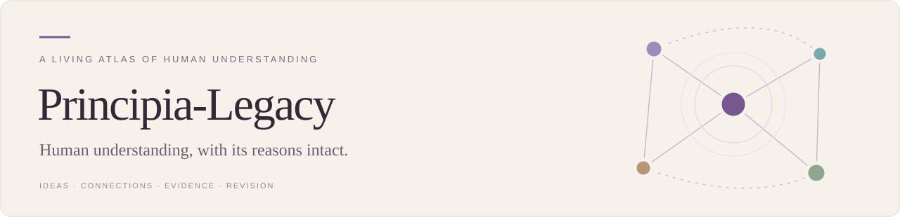
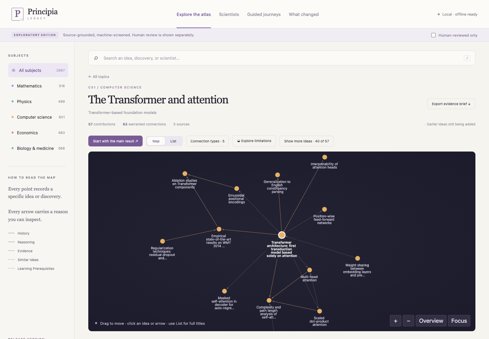

<p align="center">
  
</p>

<p align="center">
  <a href="https://atlas.chipflow.net/web/legacy/"><strong>Explore the live atlas ↗</strong></a>
  &nbsp; · &nbsp;
  <a href="#run-locally">Run locally</a>
  &nbsp; · &nbsp;
  <a href="docs/README.md">Documentation</a>
  &nbsp; · &nbsp;
  <a href="CONTRIBUTING.md">Contribute</a>
</p>

Human understanding grows through specific moves: a new representation, a decisive experiment, a useful approximation, a challenge to an accepted idea. **Principia-Legacy makes those moves—and the reasons connecting them—navigable.**

Follow a discovery into its documented foundations. See where an insight travels across subjects. Examine the evidence, assumptions, and limits that give each connection its meaning.

### A map with reasons

The atlas spans **mathematics, physics, computer science, economics, and biology & medicine**. Its unit is a specific intellectual contribution, preserved with attribution and enough explanation to understand what changed.

| What you can inspect | Why it matters |
| :--- | :--- |
| **An idea** | The problem, conceptual move, explanation, assumptions, and limits. |
| **A connection** | Its precise meaning and warrant. History, logic, evidence, analogy, and learning prerequisites remain distinguishable. |
| **A source** | The cited work and version, evidence anchors, and access state. |
| **A revision** | What changed, which reviews apply, and which interpretations need another look. Earlier releases remain reproducible. |

### Start with a discovery

1. **Find an idea, topic, or scientist.** Search, or choose a frontier exploration.
2. **Read the insight.** Open its containing topics or trace its evidenced connections.
3. **Question the arrow.** Inspect the warrant and sources, compare explanations, or explore limitations.

Try [sphere packing](https://atlas.chipflow.net/web/legacy/#dossier=M06&release=1.2.0-exploratory), [quantum memory](https://atlas.chipflow.net/web/legacy/#dossier=P01&release=1.2.0-exploratory), [the Transformer](https://atlas.chipflow.net/web/legacy/#dossier=C01&release=1.2.0-exploratory), [causal estimation](https://atlas.chipflow.net/web/legacy/#dossier=E01&release=1.2.0-exploratory), or [AlphaFold 3](https://atlas.chipflow.net/web/legacy/#dossier=B01&release=1.2.0-exploratory).

[](https://atlas.chipflow.net/web/legacy/#dossier=C01&release=1.2.0-exploratory)

**Current edition · 1.2.0-exploratory:** 2,667 insights · 2,233 relationships · 152 populated topics. Content is source-grounded and machine-screened; qualified human auditing remains outstanding. Coverage and historical ancestry are incomplete. [See the evidence and limits →](docs/STATUS.md)

### Run locally

Download this repository, extract it, and run with **Python 3.12+**:

```sh
python3 start.py
```

Open **http://127.0.0.1:8765**. On Windows, use `py -3 start.py`.

The reader works offline. Prebuilt assets are included, and the first launch rebuilds the search database from the canonical records. **No Node.js, API key, GPU, or online installation is needed to read.** [Reading guide](docs/USAGE.md) · [Development](docs/DEVELOPMENT.md) · [Hosting](hosting/README.md)

### An inheritance we can keep improving

Preserving scientific knowledge also means preserving how it became credible—and where it remains unsettled. This atlas is intended as shared infrastructure for learning, research, and correction.

The longer-term ambition is to give people and increasingly capable AI a common, inspectable record of human reasoning. Its contribution to AI alignment remains a research question.

**Help build the atlas:** contribute a sourced insight, challenge a connection, clarify an explanation, or improve the reader. [Start here →](CONTRIBUTING.md) Watch this repository to follow its development.

---

[MIT](LICENSE) for code · [CC BY 4.0](DATA_LICENSE.md) for original explanations · [Third-party rights](THIRD_PARTY_NOTICES.md) remain separate.
