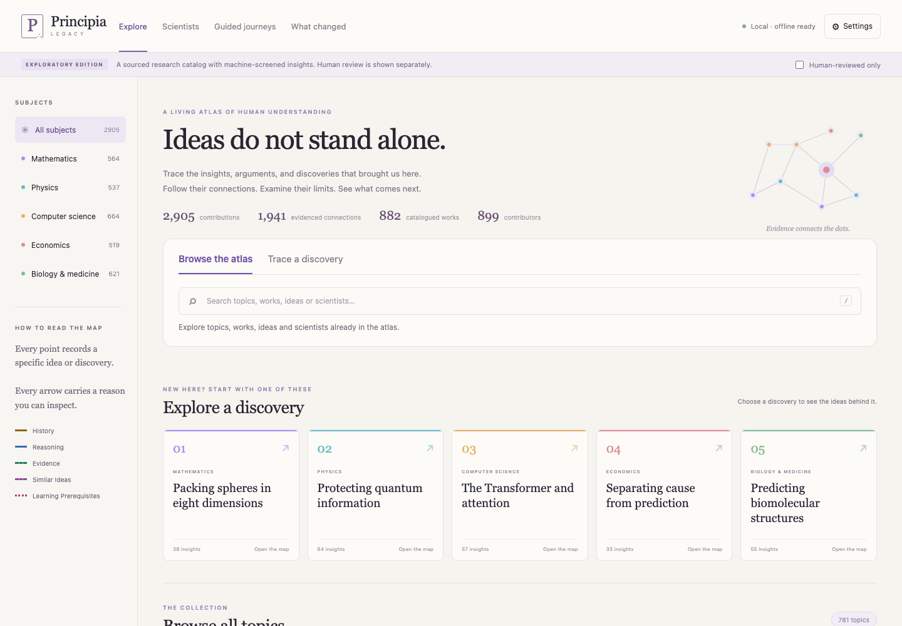

# Reading the atlas

## Run locally

Download and extract the release archive. Install Python **3.12 or later** if needed, then run from the extracted `principia-legacy` directory:

```sh
python3 start.py
```

Open **http://127.0.0.1:8765** in your browser. Keep the terminal open; press Ctrl+C to stop. On Windows use `py -3 start.py`. The archive also includes `start.command` for macOS, `start.sh` for Linux/macOS, and `start.bat` for Windows. If your archive tool drops executable permissions, use `sh start.sh` or the Python command.

The packaged reader requires **no Node.js, pip installation, API key, GPU, or internet access**. A source checkout rebuilds its missing database automatically from the bundled canonical records on first launch. Fonts, mathematical rendering, interface assets, and SQLite data are included. Source links leave the local reader only when you explicitly open them. The server accepts read-only requests on loopback; it is not a public hosting service.

If port 8765 is occupied, run `python3 start.py serve --port 8766 --offline` and open the corresponding address. `--offline` documents reader intent; browsing, diagnosis, validation and compilation never call a network provider regardless of that flag.

## Explore

1. Choose a discovery or a topic. The main result stays in the initial map; use **Show more ideas** to expand larger topics. Empty scopes remain visible with their gaps.
2. Select a contribution to read its claim, problem, key idea, explanation, assumptions and limitations.
3. Select an arrow—or open the text connection list below the map—to inspect its scope, warrant, evidence anchors and review record.
4. Use **Trace its connections** to inspect a bounded neighborhood, **Compare** to place two contributions alongside each other, and **Explore limitations** to expose limitations.
5. Export a deterministic evidence brief or inspect **What changed** between saved snapshots.

Search finds **ideas, topics and scientists**. Opening an idea keeps the search results available; use **Back to results** or the previous/next controls to continue reading. **Explore this idea in** opens every topic containing that idea, including shared topics across subjects. A person's name opens a profile with sourced information, credit notes, related ideas and topics. Profiles without biographical research say so explicitly.

Use `/` to focus search and Escape to close an inspector. The list and connection controls provide keyboard access to the same records as the canvas. On a narrow screen, the inspector opens below the reader. Subject navigation stays available as you scroll. Use Back and Forward to revisit a topic or selected contribution. The comparison panel can search for the second idea.

Arrow types retain five distinct layers: historical, logical, evidential, conceptual and pedagogical. Chronology is not evidence of influence. A diamond marks a joint inference requiring all premises. Positions help navigation; they do not establish historical or logical claims. A tour is a curated reading sequence, not proof of relationships between its stops.



## Inspect and rebuild

```sh
python3 start.py doctor
python3 start.py validate
python3 start.py build --offline
python3 start.py brief --dossier C01 --query 'attention' --output attention-brief.json
python3 scripts/verify_release.py .
```

`build` compiles the current working corpus. To restore a published snapshot, add `--release 1.3.1-exploratory`. Older manifests and record revisions remain available. Internal correction checkpoints are retained and can be explicitly rebuilt by ID; they are not all indexed into the default reader. The brief includes selected claims, complete selected relation premises, source revisions, review states, boundaries, gaps, and any explicitly supplied `--policy-profile profile.json`. Its permitted action scope is always `read_only`.

See [the data contract](CONTRACT.md), [authoring workflow](AUTHORING.md), [API reference](API.md), [evaluation protocol](EVALUATION.md), and [contribution guidance](../GOVERNANCE.md).


## Trace a discovery of your own

Use **Trace a discovery** beside **Browse the atlas**. Configure your SiliconFlow key and model in the global **Settings**. This optional online workflow sends requests directly from your browser and produces a personal draft; it never writes to the atlas server. Use **Save on this device** or **Download map** only when you want to retain it. [Progress, evidence checks, saving and privacy](PERSONAL_EXPLORATION.md).

Settings also distinguishes the reader software version from the frozen atlas snapshot. Old preview bookmarks open the same installed software. Snapshot identifiers remain in atlas reading links so older claims and corrections can be reproduced.
